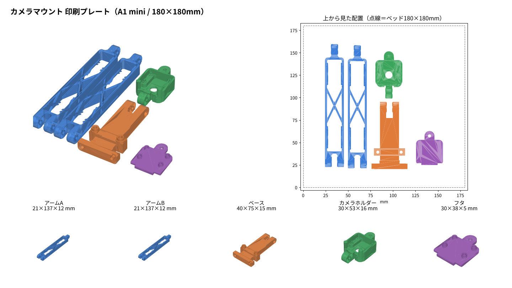

# カメラマウント（3Dプリント用データ）

ラズパイ用カメラを寝床の上に取り付けるためのマウントです。元のデータ `Camera_Lid_V3Wide_v2.5.stl` から、使わない歯車状のエンコーダー（直径約38mm）を取り除き、Bambu Lab A1 mini で1回で印刷できるようにまとめたものです。

## ファイル

| ファイル | 内容 |
|---|---|
| `CameraMount_A1mini.3mf` | **全部品を A1 mini のプレート（180×180mm）中央に配置したもの。これを開けば1回で印刷できます** |
| `stl/1_arm_a.stl` | アーム A（21×137×12mm） |
| `stl/2_arm_b.stl` | アーム B（21×137×12mm） |
| `stl/3_base.stl` | ベース（40×75×15mm） |
| `stl/4_camera_holder.stl` | カメラホルダー（30×53×16mm）。上端の丸い耳の中に入る小部品（約10×9×6mm）も含む |
| `stl/5_lid.stl` | フタ（30×38×5mm） |

全体の大きさは約131×139mm、高さ16mmで、A1 mini の造形範囲（180×180×180mm）に周囲20mm以上の余裕を持って収まります。

## 印刷のしかた（Bambu Studio）

1. `CameraMount_A1mini.3mf` を開く。「複数のオブジェクトを1つとして読み込みますか？」と聞かれたら「**いいえ**」（部品ごとに扱えるように）
2. 部品を1つだけ刷り直したいときは、`stl/` の該当ファイルを使う
3. カメラホルダーの小部品は、ホルダーの耳の中にある別の塊です。分けずにそのまま一緒に印刷してください

印刷設定（材料、充填率、サポートの要否）は元データの作者の推奨に従ってください。分からない場合は、PLA または PETG・積層0.2mm・充填20～30%から試し、スライサーのプレビューでサポートが必要な張り出しがないか確認してください。

## 注意

- 組み立てに使うネジ・ピンのサイズや組み立て手順は、元データの配布元を確認してください。
- 元データの作者・ライセンスを確認し、ここに追記してください（他の人に共有する場合、ライセンスによっては改変データの再配布に条件があります）。
  - 元データ：`Camera_Lid_V3Wide_v2.5.stl`
  - 配布元：（ここに URL を記入）
  - ライセンス：（ここに記入）
- 取り付けたマウントとケーブルは、赤ちゃんの手が絶対に届かない位置にしっかり固定してください。落下しない取り付け方法を選んでください。

## 作り方の記録

元の STL を部品ごと（つながった形状ごと）に分け、エンコーダーを除いた残りを部品ごとの STL と、部品を別オブジェクトとしてまとめた 3MF に書き出しています。元の STL には、穴のまわりに本体から切れたごく小さな面がいくつかあったため、それぞれ持ち主の部品に戻しています（三角形の数が「新データ＋エンコーダー＝元データ」で一致することを確認済み）。
